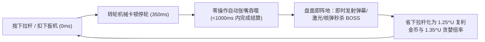

# 《Slotbound》极简爽游衍生套件 — 总纲设计哲学与架构规范 (Master Design Philosophy)

> **文档编号**：`GDD-00`  
> **所属模块**：全局顶层设计总纲 (`docs/gdd/00-master-design-philosophy.md`)  
> **关联原型**：`devour-reels`（吞噬转轮）、`revolver-dungeon`（左轮地牢）、`jackpot-td`（黄金矿工防线）、`sigil-pachinko`（咒印弹珠台）、`abyssal-grid`（深渊矩阵）

---

## 1. 核心矛盾解构：为什么要“砍掉中间商”？

### 1.1 原作痛点诊断
《Slotbound》的核心矛盾在于：**“爽快的多巴胺摇奖”被“繁琐的战前吞噬微操和冗长的自动战斗”给稀释了。**

在传统老虎机自走棋/策略衍生玩法中，玩家的体验往往被强行切割成三个割裂的阶段：
1. **摇奖抽卡阶段**：按下拉杆摇出符号，此时多巴胺刚刚分泌；
2. **繁琐微操阶段**：玩家必须停下来手动拖拽杂兵喂给主力、调整站位、计算人口上限，多巴胺迅速冷却；
3. **冗长观战阶段**：看着屏幕上的小人慢吞吞走路、平A、互殴长达 20~40 秒，玩家彻底沦为无聊的旁观者。

### 1.2 核心破局思路：“砍掉中间商” (Cut the Middleman)
要设计一款更简洁、更上头的衍生游戏，核心思路就是**“砍掉中间商”**——把**抽卡 (Spin)**、**合成 (Auto-Devour)**、**战斗 (Slot-as-Combat)** 压缩到同一个瞬间，实现**“拉杆即结算、连线即秒杀”**的高频正反馈循环！



### 1.3 传统 Slot 自走棋 vs 《Slotbound》极简爽游衍生套件对比表

| 维度 | 传统老虎机自走棋 (旧范式) | 《Slotbound》极简爽游衍生套件 (新范式) | 核心多巴胺收益 |
|------|---------------------------|----------------------------------------|----------------|
| **合成操作** | 手动拖拽杂兵喂给主力，步骤繁琐 | **零操作合成 (`Auto-Devour`)**：停轮瞬间高阶图案自动张嘴吃掉相邻低阶图案，**1秒内完成结算 (`<1000ms`)** | 消除微操疲劳，保留纯粹暴食爽感 |
| **战斗呈现** | 独立战斗阶段，看小人慢吞吞走路打架 | **即时开火 (`Slot-as-Combat`)**：老虎机面板本身就是阵地，连线瞬间直接发射弹幕或满屏激光 | 摇一次打一轮，拉杆与秒杀零延迟绑定 |
| **经济博弈** | 固定每回合发放死板金币 | **极简赌狗经济 (`Risk & Greed`)**：每波固定拉杆倒计时（5次），省下的拉杆直接变成下一关复利与稀有词条倍率 | 在“稳健清场”与“极限贪利息”间反复横跳 |
| **数值成长** | 保守的线性加法（攻击力 `+2`） | **指数级数字膨胀**：`基础点 × 连线倍率 × 吞噬层数 × 连锁倍率 × 贪婪倍率`，5分钟内飙升至千万/破亿 | 屏幕震动、数字突破天际的破格爽感 |
| **单局节奏** | 单回合 45~90 秒，双手频繁切换 | **15秒心流法则**：单回合闭环严控在 `10~15秒` 内，全程单手鼠标或空格键 (`Spacebar`) 到底 | 进入“无脑再来一局”的催眠心流状态 |

---

## 2. 极简重构核心公式 (Three Pillars of Minimalist Reconstruction)

### 2.1 第一支柱：零操作合成 (`Auto-Devour`)
* **设计定义**：彻底取消手动把杂兵喂给主力的拖拽操作。当老虎机停下时 (`t = 350ms`)，场上的高阶图案（捕食者 Predator）**自动张嘴吃掉**周围相邻的低阶图案（食材 Prey），直接跳数字涨属性并播放暴食特效，**1秒内完成结算 (`< 1000ms`)**。
* **确定性结算优先级**：
  1. 按图案阶位从高到低（`Tier 4 -> Tier 3 -> Tier 2`）依次扫描盘面；
  2. 同阶图案按盘面索引从左到右、从上到下（`Index 0 -> N`）顺序执行；
  3. 每次吞噬立即累加基础点 (`+BasePoints`) 与本轮吞噬层数 (`+DevourStacks`)，并触发双层清脆咀嚼音效 (`playDevourCrunch`)。

### 2.2 第二支柱：即时开火 (`Slot-as-Combat`)
* **设计定义**：砍掉独立的“看小人慢吞吞走路打架”阶段。`3×3` 的老虎机面板、`6发` 左轮弹巢、`1×5` 单线防线本身就是你的阵地！连线或吞噬成功的瞬间，格子里的兵种/子弹/防御塔直接向屏幕上方的怪物发射弹幕、引爆肚内火药桶或释放长达 5 秒的狂暴激光洗地，**摇一次打一轮**。

### 2.3 第三支柱：极简赌狗经济 (`Risk & Greed`)
* **设计定义**：引入《小丑牌》（Balatro）式的过关底分与利息机制。每波怪物有固定的血量与拉杆倒计时（默认限制 `5` 次拉杆内击杀）。
* **核心贪婪博弈**：你省下的每一次拉杆 $U$ 都会变成下一关的复利金币 ($\text{InterestGold} \propto 1.25^U$) 或者永久稀有词条贪婪倍率 ($\text{GreedMultiplier} \times 1.35^U$)，逼迫玩家在**“稳健多拉一杆清场”**和**“极限少拉一杆贪利息”**之间反复横跳。

---

## 3. 五大可玩原型矩阵总览 (5 Playable Schemes Matrix)

为充分探索不同维度的极简爽游玩法，本套件落地了 **3 个核心主推方案** 与 **2 个拓展探索方案**，全部共享底层数学、音效与经济引擎：

| 方案代号 | 中文名称 | 英文 ID | 盘面拓扑 | 核心机制与独有爽点 | 对应设计文档 |
|----------|----------|---------|----------|--------------------|--------------|
| **方案一** | **《吞噬转轮》** | `devour-reels` | `3×3` 盘面 + 中央**深渊巨口** | 连线单位直接作为**食材**掉进巨口；`3个铁甲骑士`喂出重甲反伤；`火球+炸药桶`引发肚内连锁爆炸；`消化不良`槽管理与无脑**改轮盘概率** | [`02-scheme1-devour-reels.md`](02-scheme1-devour-reels.md) |
| **方案二** | **《左轮地牢》** | `revolver-dungeon` | `6发弹巢` 环形左轮手枪 | 极简双按钮：**“旋转弹巢并开火”** 或 **“塞入新子弹”**；`寄生弹`吞噬相邻子弹翻倍；`火药+引信+重锤`触发**连发清空整个弹巢**；`恶魔弹` 25% 炸膛豪赌 | [`03-scheme2-revolver-dungeon.md`](03-scheme2-revolver-dungeon.md) |
| **方案三** | **《黄金矿工防线》** | `jackpot-td` | `1排5格` (`1×5`) 单线塔防底座 | 怪物实时往下走，狂按拉杆瞬间刷新 5 塔并开火；`对子`自动合成**二星 (`★★`)**；`三连冰冻`绝境救场；`顺子或五连`触发**长达 5 秒的狂暴激光洗地**与**五连核弹** | [`04-scheme3-jackpot-td.md`](04-scheme3-jackpot-td.md) |
| **方案四** | **《咒印弹珠台》** | `sigil-pachinko` | `1×3` 发生器 + `24` 咒印钉 + `5` 坩埚 | 高阶法球下落途中与低阶法球发生**空中碰撞自动吞噬**；撞击钉板触发半音阶升调；`狂暴摇台 (Chaos Tilt)` 强推合成巨球入 `×25 JACKPOT` 坩埚 | [`05-explorations-pachinko-grid.md`](05-explorations-pachinko-grid.md) |
| **方案五** | **《深渊矩阵》** | `abyssal-grid` | `4×4` 锁格战棋矩阵 (`10线` Bingo) | 高阶统帅摇出即自动锁格 (`🔒 HOLD`)，每轮重摇自动十字吞噬正交相邻杂兵；凑齐横/竖/斜 `10线 Bingo` 触发矩阵毁灭齐射 | [`05-explorations-pachinko-grid.md`](05-explorations-pachinko-grid.md) |

---

## 4. 工程目录结构与模块边界契约 (Directory Architecture & Contracts)

### 4.1 标准化工程目录树
```text
/home/antigravity/
├── PROJECT.md                              # 全局架构规范与接口契约
├── README.md                               # 快速启动与设计文档索引
├── package.json                            # 原生 ES2024 Module 配置
├── index.html                              # 统一街机大厅入口
├── docs/gdd/                               # 6份完整中文游戏设计文档
│   ├── 00-master-design-philosophy.md
│   ├── 01-iron-laws-math-and-audio.md
│   ├── 02-scheme1-devour-reels.md
│   ├── 03-scheme2-revolver-dungeon.md
│   ├── 04-scheme3-jackpot-td.md
│   └── 05-explorations-pachinko-grid.md
├── src/
│   ├── core/                               # 零 DOM 依赖的纯确定性核心层 (Node & Browser 双端通用)
│   │   ├── PRNG.js                         # Mulberry32 种子随机数引擎
│   │   ├── BigNumber.js                    # K/M/B/T 与 万/亿 大数格式化及震动分级
│   │   ├── ScoreFormula.js                 # Balatro 指数级伤害结算公式
│   │   ├── EconomyEngine.js                # 省下拉杆复利、贪婪倍率与遗物三选一引擎
│   │   ├── EventBus.js                     # 解耦事件总线与环形日志队列
│   │   └── FlowTracker.js                  # 15秒心流与 <1000ms 自动吞噬结算监控器
│   ├── audio/
│   │   └── SoundEngine.js                  # Web Audio API 零资产程序化音效合成器
│   ├── ui/
│   │   ├── VFXCanvas.js                    # 60fps 2D Canvas 弹幕/吞噬粒子/5秒激光/震屏渲染器
│   │   ├── HUDController.js                # 共享 Balatro 风格乘区分解 HUD 横幅
│   │   └── GDDViewer.js                    # 内置交互式 GDD 阅读器（支持一键启动对应原型）
│   └── games/                              # 5大独立玩法模块 (Engine + View 严格分离)
└── tests/                                  # 单元测试 (tests/unit/) 与端到端测试 (tests/e2e/)
```

### 4.2 纯逻辑引擎与视图层分离契约 (`Engine` ↔ `View`)
* **零 DOM 污染原则**：`src/core/*` 与所有 `src/games/*/*Engine.js` 严禁直接依赖浏览器 `window` 或 `document`，确保在 `Node.js` 环境 (`node --test`) 下无需浏览器即可进行 100% 确定性的数学、状态机与种子回放验证。
* **统一遥测桥接 (`window.__SLOTBOUND__` & `window.__AUDIO_LOG__`)**：在浏览器端，所有方案统一挂载至 `window.__SLOTBOUND__`（及别名 `window.__SLOTBOUND_TEST__`），支持确定性设置种子 (`setSeed`)、强制注入盘面 (`forceNextSpin`)、单步推进物理时间 (`stepSimulation`) 以及实时读取完整状态快照 (`getState`)。


---

## 5. 统一状态快照与跨方案接口规范 (`Unified State Snapshot Contract`)

为保证五大原型在统一街机大厅 (`index.html`) 与自动化测试桥 (`window.__SLOTBOUND__`) 中无缝切换，所有 `*Engine.js` 的 `getState()` 返回结构遵循以下标准字段字典：

| 字段名称 | 类型 | 适用范围 | 设计含义与用途 |
|----------|------|----------|----------------|
| `schemeId` | `string` | 全方案共享 | 当前激活方案标识 (`'devour-reels'` / `'revolver-dungeon'` / `'jackpot-td'` / `'sigil-pachinko'` / `'abyssal-grid'`) |
| `seed` | `number` | 全方案共享 | Mulberry32 确定性随机种子，相同种子保证 100% 相同的摇奖与暴击序列 |
| `wave` | `number` | 全方案共享 | 当前波次或地牢层数 (`1..8`) |
| `gold` | `number` | 全方案共享 | 当前持有的赌狗金币数量 |
| `interestRate` | `number` | 全方案共享 | 复利利率（默认 `0.25` 即 `25%`） |
| `greedMultiplier` | `number` | 全方案共享 | 由省下拉杆数 $U$ 累乘的全局贪婪倍率 ($1.35^U$) |
| `pullsRemaining` | `number` | 全方案共享 | 当前波次剩余可用拉杆/击发次数（初始 `5` 次） |
| `playerHp` / `enemyHp` | `number` | 全方案共享 | 玩家基地/自身生命值 与 当前首领剩余生命值 |
| `lastTurnBreakdown` | `object` | 全方案共享 | 最近一次结算的完整乘区拆解（`basePoints`, `lineMultiplier`, `devourStacks`, `devourStacksMultiplier`, `chainSynergyMultiplier`, `greedMultiplier`, `totalDamage`, `settlementDurationMs`） |
| `indigestion` / `mawArmor` | `number` | 方案一专属 | 深渊巨口的消化不良值 (`0..100`) 与反伤护甲值 |
| `chambers` / `backfireRisk` | `array/number` | 方案二专属 | 6发左轮弹巢实时子弹阵列与当前恶魔弹炸膛风险概率 |
| `pedestals` / `activeEffects` | `array/object` | 方案三专属 | 1×5 防御塔底座星级/吞噬状态与全屏冰冻/5秒狂暴激光剩余时间 |
| `orbs` / `pegs` / `crucibles` | `array` | 方案四专属 | 炼金法球实时坐标、24枚咒印钉充能状态与底部5口倍率坩埚 |
| `matrix` / `lockedCells` / `bingoLines` | `array` | 方案五专属 | 4×4 战棋矩阵、已锁定统帅格 (`🔒 HOLD`) 与已达成的十线 Bingo 索引 |
| `pendingRelicDraft` | `array \| null` | 全方案共享 (R2) | 波次击破后生成的 3 张非阻塞候选遗物卡组（点击或按 `[1-3]` 立即选取，直接拉杆自动收入首张） |
| `victory` / `endlessMode` / `gameOver` | `boolean` | 全方案共享 (R2) | 第 8 波通关胜利标记、Wave 9+ 无尽冲分模式激活态与生命耗尽败北标记 |

---

## 6. 第二轮视觉重构与工业级打磨规范 (`Round 2 Casino-Dungeon Visual & Tactile Overhaul`)

为彻底消除原型期的“测试工具页感”，第二轮架构升级在不引入任何外部图片/音频文件的前提下，构建了完整的暗黑赌场机台视觉与闭环反馈体系：

1. **黑曜石、拉丝黄铜与猩红赌桌绒布视觉系统 (`Obsidian, Brushed Brass & Crimson Felt`)**：
   * 摒弃通用紫色后台配色，采用深渊黑曜石 (`#090807`)、拉丝黄铜 (`#c89b3c` / `#f3cf7a`)、猩红绒布 (`#2d1317`) 与炼金翡翠 (`#06d6a0`)，在桌面端 `1440×900` 严格贴合 **`100vh` 一屏居中机台布局**，并将调试沙盒收纳为右下角可折叠抽屉 (`sandbox-toolbar`)。
2. **程序化多图层矢量锻造厂 (`src/ui/SpriteForge.js`)**：
   * 统一由 `renderSprite(id, options)` 与 `renderBossPortrait(boss, options)` 实时生成 `64×64` 多图层金属倒角实体徽章与 `120×120` 首领动态立绘（覆盖全 5 方案所有符号、子弹、炮塔、法球、咒印钉、战棋单位、8 件遗物与 40 尊波次首领），零原生 OS Emoji 依赖。
3. **非阻塞式遗物构筑与胜负闭环 (`src/ui/RelicDraftBanner.js`)**：
   * 每波通关即时弹出三选一遗物横幅 (`relic-draft-banner`)，支持点击选卡、`[1-3]` 快捷键或直接继续拉杆无感自动收卡；第 8 波击败终极首领后弹出胜利横幅 (`run-victory-banner`) 支持进入 **Wave 9+ 无尽冲分模式 (`btn-endless-mode`)**；生命值归零时弹出败北重开横幅 (`run-defeat-banner`)。

