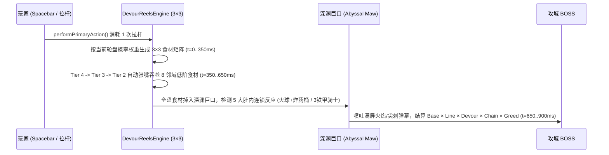

# 方案一：《吞噬转轮》(Devour Reels) — 怪兽养成与弹幕直伤游戏设计文档

> **文档编号**：`GDD-02`  
> **所属模块**：方案一完整游戏设计文档 (`docs/gdd/02-scheme1-devour-reels.md`)  
> **代码映射**：`src/games/devour-reels/config.js`、`src/games/devour-reels/DevourReelsEngine.js`、`src/games/devour-reels/DevourReelsView.js`

---

## 1. 核心概念与 3×3 深渊巨口盘面拓扑

### 1.1 核心设计定位
* **核心循环**：你不是在召唤军团，你养的就是盘面正中央的一只**“深渊巨口” (`Abyssal Maw`)**。`3×3` 盘面每次摇出各种勇者、哥布林、宝箱、铁甲骑士、火球、炸药桶或诅咒物。
* **极简爽点**：连线生成的单位不是用来站场的，而是**直接作为食材掉进巨口里**。摇出**“3个铁甲骑士”**等于喂给巨口顿挫感极强的护甲与反伤；摇出**“火球+炸药桶”**直接在怪兽肚子里引发连锁爆炸，喷出满屏火焰秒杀面前的攻城 BOSS。
* **上头机制**：没有场地人口限制，只有**“消化不良”槽 (`Indigestion Meter 0..100`)**。玩家只需要无脑**改轮盘概率 (`Wheel Probability Modder`)**，追求一发拉杆触发十几种食材的连锁反应（`Chain Reaction`），看伤害数字从几十直接飙到几千万！

### 1.2 3×3 盘面与 8 条连线拓扑结构
盘面采用标准 `3×3` 九宫格（索引 `0..8`），正中央 (`Cell 4`) 悬浮着可不断进化的**深渊巨口 (`data-testid="abyssal-maw"`)**：

```text
+-------------------+-------------------+-------------------+
| Cell 0 (左上)     | Cell 1 (中上)     | Cell 2 (右上)     |
+-------------------+-------------------+-------------------+
| Cell 3 (左中)     | Cell 4 [深渊巨口] | Cell 5 (右中)     |
+-------------------+-------------------+-------------------+
| Cell 6 (左下)     | Cell 7 (中下)     | Cell 8 (右下)     |
+-------------------+-------------------+-------------------+
```

* **8条标准连线 (`PAYLINES`)**：
  * 横向 3 条：`[0,1,2]`、`[3,4,5]`、`[6,7,8]`
  * 纵向 3 条：`[0,3,6]`、`[1,4,7]`、`[2,5,8]`
  * 对角线 2 条：`[0,4,8]`、`[2,4,6]`
* **8邻域吞噬半径**：每个格子周围的 8 个正交与对角相邻格均为其捕食范围；处于盘面正中央的 `Cell 4` 与其余全部 8 个格子相邻！

---

## 2. 完整 9 种食材图案图鉴表 (`9 Symbols Catalog across 4 Tiers`)

| 图案 ID (`id`) | 中文名称 | 图标 | 阶位 (`Tier`) | 基础点数 (`BasePoints`) | 初始轮盘权重 (`Weight %`) | 消化负担 (`Indigestion`) | 零操作自动吞噬与投喂效果 (`Auto-Devour & Feed Role`) |
|----------------|----------|------|---------------|-------------------------|---------------------------|--------------------------|------------------------------------------------------|
| `goblin` | **哥布林杂兵** | 👺 | Tier 1 (食材) | `12` | `22%` | `+4` | 脆皮多汁的基础肉食；被高阶单位吞噬时额外提供 `+15` 点数与 `+1` 吞噬层数 |
| `chest` | **黄金宝箱** | 📦 | Tier 1 (食材) | `10` | `14%` | `+3` | 摇出即送 `+12 Gold`；被吞噬时爆出 `+25 Gold` 并触发勇者盛宴 |
| `powder_keg` | **黑火药桶** | 🛢️ | Tier 1 (食材) | `20` | `12%` | `+5` | 高危爆破食材；接触 `fireball` 立即引发**肚内连锁大爆炸** |
| `curse_skull` | **诅咒骨颅** | 💀 | Tier 1 (诅咒) | `5` | `10%` | `+18` | 剧毒异物，大幅增加消化不良；但被 `abyss_apostle` 吞噬时转化为 `×8.0` 腐蚀倍率 |
| `iron_knight` | **铁甲骑士** | 🛡️ | Tier 2 (捕食者) | `35` | `13%` | `+8` | 自动吞噬周围 Tier 1 食材；每只赋予巨口 `+30` 护甲，凑齐 3 只触发**重甲反伤风暴** |
| `fireball` | **烈焰火球** | 🔥 | Tier 2 (捕食者) | `45` | `12%` | `-5` | 自动引燃并吞噬周围 `powder_keg` 与 `goblin`，触发满屏烈焰吐息 |
| `digestive_herb` | **消食圣果** | 🌿 | Tier 2 (净化) | `25` | `5%` | `-35` | 立即净化巨口 `-35` 点消化不良，并将已消化的胃酸转化为 `+1.5x` 连线倍率 |
| `hero_berserker` | **狂战勇者** | ⚔️ | Tier 3 (高阶捕食) | `75` | `8%` | `+10` | 凶猛吞噬周围所有 Tier 1 & Tier 2 单位，每吞 1 个额外提供 `+2` 吞噬层数 |
| `abyss_apostle` | **深渊使徒** | 👁️ | Tier 4 (顶级捕食) | `150` | `4%` | `-10` | 盘面最高阶主宰，通吃周围 Tier 1~3 一切单位（含诅咒骨颅），吞噬倍率翻倍 |

*(注：初始轮盘权重总和严格为 $22 + 14 + 12 + 10 + 13 + 12 + 5 + 8 + 4 = 100\%$。)*

---

## 3. 零操作 8 邻域自动吞噬与 5 大肚内连锁反应 (`Auto-Devour & 5 Stomach Chain Reactions`)

### 3.1 `< 1000ms` 零操作自动吞噬算法
当 `3×3` 转轮停下瞬间，无需任何手动拖拽：
1. 系统按 `Tier 4 -> Tier 3 -> Tier 2` 顺序唤醒盘面上的捕食者；
2. 每个捕食者自动张嘴吞噬其 8 邻域内所有阶位更低 (`target.tier < predator.tier`) 的图案；
3. 随后，盘面所有剩余与已强化单位被中央**深渊巨口**一口吸入腹中，触发肚内化学连锁反应并在 **1秒内完成全部结算 (`< 1000ms`)**。

### 3.2 五大肚内连锁反应配方表 (`5 Stomach Chain Reactions`)

| 连锁 ID | 连锁反应名称 | 触发条件 (盘面/腹中组合) | 连锁倍率 (`ChainSynergyMultiplier`) | 特殊机制与视觉爆发效果 |
|---------|--------------|--------------------------|-------------------------------------|------------------------|
| `fireball_powder_keg` | **🔥 肚内连锁大爆炸 (`Fireball + Powder Keg`)** | 盘面同时存在 `>= 1` 个 `fireball` 与 `>= 1` 个 `powder_keg` | `×6.0`（每多1个桶或火球额外 `+×2.0`，最高 `×12.0`） | 火球在怪兽肚子里引爆所有炸药桶，清理 `-15` 消化不良，巨口喷出满屏烈焰直接秒杀攻城 BOSS！ |
| `triple_iron_knights` | **🛡️ 重甲反伤风暴 (`3× Iron Knights`)** | 盘面摇出 `>= 3` 个 `iron_knight` | `×4.5` | 喂给巨口顿挫感极强的重甲 (`+120 Maw Armor`) 与 `100%` 荆棘反伤，向 BOSS 齐射满屏铁处女尖刺 |
| `hero_banquet` | **🍖 勇者饕餮盛宴 (`Hero Banquet`)** | `hero_berserker` 搭配 `goblin` + `chest` | `×3.5` | 勇者在巨口腹中大摆筵席，额外爆出 `+50 Gold` 并赋予 `+3` 额外吞噬层数 |
| `curse_transmutation` | **☠️ 剧毒化魔炼成 (`Curse Transmutation`)** | `abyss_apostle` 搭配 `curse_skull`（或 `>= 3` 个 `curse_skull`） | `×8.0` | 将剧毒诅咒骨颅转化为深渊黑洞能量，立即净化 `-25` 消化不良并造成巨额腐蚀暴击 |
| `full_board_gluttony` | **🌌 饕餮吞天 (`Full-Board Gluttony`)** | 单次拉杆发生 `>= 5` 次邻域吞噬或盘面无重样满汉全席 | `×10.0` | 触发最高阶 Tier 4 满屏震动，深渊巨口永久进化一阶 |

---

## 4. “消化不良”槽 (`Indigestion Meter 0..100`) 与酸液喷发机制

* **消化不良累积**：每次拉杆喂食后，根据吞入食材的 `Indigestion` 值增减 `indigestion`（范围 `0..100`，绑定 `data-testid="indigestion-meter"`）。
* **酸液超载喷发 (`Bile Eruption` — 当 `indigestion >= 100`)**：
  * 当消化不良槽达到 `100` 时，深渊巨口发生剧烈胃痉挛并触发**酸液喷发 (`Bile Eruption`)**；
  * **标准状态**：巨口呕出积攒的全部酸液，对当前 BOSS 额外造成 `×3.0` 胃酸爆发伤害，同时因反胃消耗 `25` 点巨口护甲（或 `-10` 玩家生命），随后消化不良重置为 `30`；
  * **携带遗物【胃酸狂暴核 (`acid_reflux_core`)】**：负面惩罚完全免疫，酸液喷发直接进化为 **`×15.0` 胃酸海啸**，让“故意吃撑巨口”成为极具爽感的极限流派！

---

## 5. 无脑改轮盘概率系统 (`Wheel Probability Modder`) 与三大流派预设

玩家无需管理场地格子，只需在右侧**轮盘概率改装面板 (`data-testid="prob-mod-panel"`)** 中消耗少量金币或免费点数无脑改概率：

1. **单图案定向加权 (`Boost / Banish`)**：
   * 点击图案旁的 `+概率`（如 `data-testid="prob-boost-fireball"`、`data-testid="prob-boost-powder_keg"`），将该图案权重提升 `+8%` 并自动归一化全盘 `100%` 概率分布。
2. **三大一键流派预设 (`Build Presets`)**：
   * **`🔥 爆破流预设` (`data-testid="prob-preset-pyro"`)**：将 `fireball` (`30%`) 与 `powder_keg` (`30%`) 权重拉满，高频触发“火球+炸药桶”肚内连锁大爆炸。
   * **`🛡️ 铁甲反伤流预设` (`data-testid="prob-preset-iron"`)**：将 `iron_knight` (`38%`) 与 `chest` (`22%`) 权重拉满，稳定触发“3个铁甲骑士”重甲反伤。
   * **`🩸 狂战暴食流预设` (`data-testid="prob-preset-gluttony"`)**：将 `hero_berserker` (`24%`)、`abyss_apostle` (`16%`) 与 `goblin` (`32%`) 拉满，追求单回合 6+ 层吞噬指数膨胀。

---

## 6. 八大攻城 BOSS 序列与 UI / 测试锚点规范

| 波次 | 攻城 BOSS 名称 | 血量 (`enemyMaxHp`) | 攻城攻击力 | 专属词条 |
|------|----------------|---------------------|------------|----------|
| **Wave 1** | **攻城木槌车 (Battering Ram Cart)** | `120 HP` | `10` | 基础靶机，适合测试首轮吞噬 |
| **Wave 2** | **黑铁盾墙阵 (Iron Phalanx)** | `650 HP` | `15` | 高甲推进 |
| **Wave 3** | **炼金投石巨兽 (Alchemical Trebuchet)** | `3,800 HP` | `22` | 投掷诅咒骨颅增加消化不良 |
| **Wave 4** | **蒸汽攻城塔 (Steam Siege Tower)** | `25,000 HP` | `30` | 重装护盾 |
| **Wave 5** | **深渊破城龙 (Abyssal Siege Drake)** | `180,000 HP` | `42` | 烈焰吐息 |
| **Wave 6** | **黄金泰坦巨像 (Golden Titan Colossus)** | `1,500,000 HP` | `55` | 击破奖励双倍金币 |
| **Wave 7** | **冥界骸骨要塞 (Necro Bone Citadel)** | `12,000,000 HP` | `70` | 千万级血牛 |
| **Wave 8** | **神罚天穹母舰·奥米茄 (Omega Siege Dreadnought)** | `85,000,000 HP` | `95` | 8500万终极攻城 BOSS |


---

## 7. 方案一单回合状态机与 UI 测试锚点契约 (`DOM data-testid Spec`)

### 7.1 单次拉杆 `< 1000ms` 内部结算流水线


### 7.2 方案一专属 DOM `data-testid` 契约表
| `data-testid` 属性值 | 对应 UI 组件 | 交互行为与状态验证 |
|----------------------|--------------|--------------------|
| `devour-grid` | `3×3` 九宫格转轮主容器 | 包含 `devour-cell-0` 至 `devour-cell-8` 共 9 个槽位 |
| `devour-cell-0` .. `devour-cell-8` | 单个食材格子 | 展示图案图标、名称、阶位、当前点数及被吞噬动画 |
| `abyssal-maw` | 盘面正中央深渊巨口组件 | 展示巨口进化等级、当前护甲 (`mawArmor`) 与张嘴吞噬脉冲特效 |
| `indigestion-meter` | `0..100` 消化不良进度槽 | 实时反映 `indigestion` 数值，满 `100` 触发酸液喷发 (`Bile Eruption`) |
| `btn-spin-devour` | 主操作按钮 `[拉杆喂食巨口 (Space)]` | 点击或按空格触发摇奖、自动吞噬与弹幕开火 |
| `prob-mod-panel` | 轮盘概率改装控制面板 | 实时展示 9 种图案的精确百分比权重（总和 `100%`） |
| `prob-boost-fireball` | 火球概率提升按钮 | 提升 `fireball` 出现权重并重算归一化百分比 |
| `prob-boost-powder_keg` | 炸药桶概率提升按钮 | 提升 `powder_keg` 出现权重并重算归一化百分比 |
| `prob-preset-pyro` | `🔥 爆破流` 一键预设按钮 | 切换至火球+炸药桶高频连锁权重配置 |
| `prob-preset-iron` | `🛡️ 铁甲反伤流` 一键预设按钮 | 切换至铁甲骑士+宝箱高护甲反伤配置 |
| `prob-preset-gluttony` | `🩸 狂战暴食流` 一键预设按钮 | 切换至狂战勇者+深渊使徒+哥布林高吞噬层数配置 |

---

## 8. 第二轮战术经济闭环与三栏机台布局 (`Round 2 Tactical Workshop & 3-Column Arena`)

1. **三栏同屏首领对决台 (`.devour-reels-stage--3col`)**：
   * **左栏（攻城首领竞技场 `boss-arena-card`）**：实时渲染当前波次首领 `120×120` 矢量立绘 (`boss-portrait-svg`)、首领专属词条徽章与双层缓降血条；
   * **中栏（`3×3` 深渊巨口转轮井）**：9 格拉丝黄铜卡槽全量采用 `SpriteForge` 矢量徽章，`Cell 4` 嵌合动态咬合的深渊巨口核心，下方紧接巨型 3D 拉杆按钮 (`btn-spin-devour`)；
   * **右栏（紧凑单屏轮盘概率改装台 `prob-mod-panel`）**：9 行图案概率条与三流派预设紧凑排布于单屏内，零纵向溢出。
2. **金币驱动的改装与主动胃酸战术**：
   * **有代价的轮盘改装**：定向 `+概率` (`15G`)、`-剔除` (`20G`) 与流派预设切换 (`30G`) 接入赌狗金库，让省杆复利赚取的每一枚金币都能转化为实打实的出牌率优势；
   * **主动喷吐胃酸 (`btn-belch-purge`)**：当 `indigestion >= 50` 时可主动释放积攒胃酸，清空 `-50` 消化不良并赋予下一发拉杆额外胃酸腐蚀倍率；
   * **深渊巨口进化升级 (`btn-upgrade-maw`)**：消耗金币直接强化 `mawLevel` 与常驻反伤重甲，构筑高阶暴食流派。

