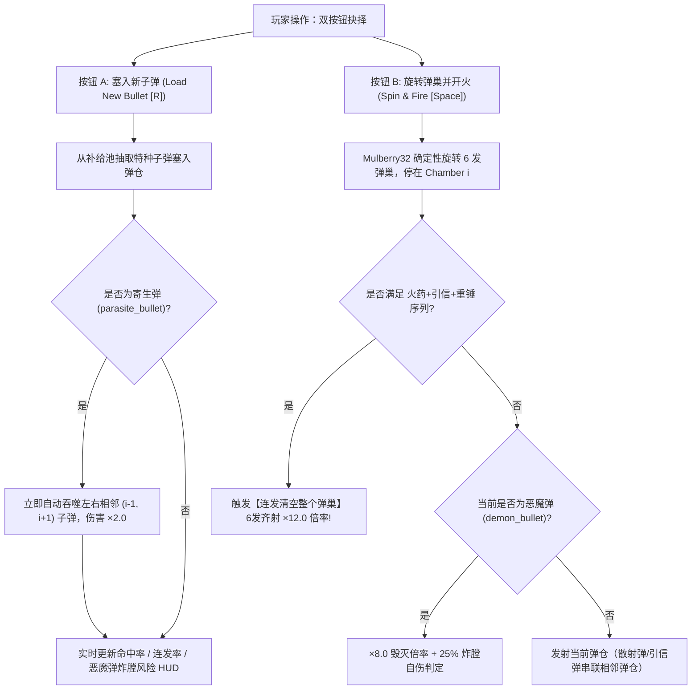

# 方案二：《左轮地牢》(Revolver Dungeon) — 俄罗斯轮盘 + 极简爬塔游戏设计文档

> **文档编号**：`GDD-03`  
> **所属模块**：方案二完整游戏设计文档 (`docs/gdd/03-scheme2-revolver-dungeon.md`)  
> **代码映射**：`src/games/revolver-dungeon/config.js`、`src/games/revolver-dungeon/RevolverDungeonEngine.js`、`src/games/revolver-dungeon/RevolverDungeonView.js`

---

## 1. 核心概念与 6 发左轮弹巢拓扑

### 1.1 核心设计定位
* **核心循环**：将 `3×3` 老虎机进一步降维成一把 **6发弹巢的左轮手枪 (`6-Chamber Revolver Cylinder`)**。面对眼前的地牢怪物，你每回合的操作只有两个按钮：**“旋转弹巢并开火 (`Spin & Fire [Space]`)”** 或 **“塞入新子弹 (`Load New Bullet [R]`)”**。
* **极简爽点**：弹巢里可以塞入**普通铅弹**、**吸血弹**、**散射弹**，甚至是会吞噬相邻子弹来翻倍伤害的**“寄生弹 (`Parasite Bullet`)”**。扣下扳机时，不仅发射当前格子的子弹，若相邻格子满足特定顺序（如**“火药+引信+重锤”**），会瞬间触发**连发清空整个弹巢 (`Full Cylinder Dump`)**！
* **上头机制**：保留了俄罗斯轮盘的天然紧张感（比如塞入高倍率但有概率炸膛扣自己血的**“恶魔弹 (`Demon Bullet`)”**）。一局战斗仅需 **15 秒**，死得快、爽得更快，极度契合短视频时代的直觉体验。

### 1.2 6 发环形弹巢拓扑结构 (`Chambers 0..5`)
弹巢由 6 个顺时针排列的环形弹仓组成（绑定 `data-testid="revolver-cylinder"` 及 `data-testid="chamber-0"` .. `data-testid="chamber-5"`）：

```text
              [ Chamber 0 : 顶部击发位 🔥 ]
             /                             \
    [ Chamber 5 ]                       [ Chamber 1 ]
         |                                   |
    [ Chamber 4 ]                       [ Chamber 2 ]
             \                             /
              [ Chamber 3 : 底部装填位 ⚙️ ]
```

* **环形邻接法则**：任意弹仓 $i \in \{0,1,2,3,4,5\}$ 的逆时针前驱为 $(i + 5) \bmod 6$，顺时针后继为 $(i + 1) \bmod 6$。
* **严格双按钮交互人体工学**：
  1. **`[旋转弹巢并开火 / Spin & Fire (Space)]` (`data-testid="btn-spin-fire"`)**：使用确定性 PRNG 随机旋转弹巢停在某一击发位 $i$，触发邻域吞噬、连锁序列判定与开火结算。
  2. **`[塞入新子弹 / Load New Bullet (R)]` (`data-testid="btn-load-bullet"`)**：从弹药补给池抽取一枚新特种弹塞入空弹仓（或替换最低阶弹仓），若塞入**寄生弹**则立即自动张嘴吞噬左右相邻子弹！

---

## 2. 完整 9 种特种子弹图鉴表 (`9 Bullet Types Catalog`)

| 子弹 ID (`id`) | 中文名称 | 图标 | 阶位 (`Tier`) | 基础伤害 (`BasePoints`) | 弹巢倍率 (`Mult`) | 核心吞噬与连锁机制 (`Adjacency & Devour Mechanics`) |
|----------------|----------|------|---------------|-------------------------|-------------------|-----------------------------------------------------|
| `empty` | **空弹仓** | ⚪ | Tier 0 | `0` | `×1.0` | 扣中空仓虽不发射实体弹，但弹巢中每个空仓都会为其余实弹提供 **孤胆轮盘 (`×2.0`)** 赌命加成 |
| `lead_bullet` | **普通铅弹** | 🔫 | Tier 1 | `25` | `×1.2` | 稳定可靠的基础实弹；作为 `parasite_bullet` 最优质的吞噬口粮 |
| `vampire_bullet` | **猩红吸血弹** | 🩸 | Tier 2 | `40` | `×1.8` | 击发时立即回复玩家 `+15 HP`；若生命已满则将溢出治疗转化为 `+×1.5` 鲜血暴击倍率 |
| `scatter_bullet` | **霰弹散射弹** | 💥 | Tier 2 | `35` | `×2.5` | 喷射扇形弹幕，并同时引燃左右相邻两个弹仓 `(i-1)` 与 `(i+1)` 的子弹协同开火 |
| `parasite_bullet` | **深渊寄生弹** | 🐛 | Tier 3 | `60` | `×3.0` | **零操作吞噬核心**：自动吞噬左右相邻弹仓的子弹！每吞掉 1 颗子弹，自身基础伤害翻倍 (`×2.0`) 并叠加 `+2 DevourStacks` |
| `powder_charge` | **浓缩火药弹** | 🧨 | Tier 2 | `30` | `×2.0` | 强化顺时针下一格弹仓 `+100%` 基础伤害；**“火药+引信+重锤”三连序列组件 A** |
| `fuse_cord` | **导爆引信弹** | 🧵 | Tier 2 | `30` | `×2.2` | 串联前后相邻弹仓实现二连发；**“火药+引信+重锤”三连序列组件 B** |
| `heavy_hammer` | **破城重锤弹** | 🔨 | Tier 3 | `90` | `×3.5` | 势大力沉的重型穿甲弹（触发重型枪声 `playGunshot(true)`）；**“火药+引信+重锤”三连序列组件 C** |
| `demon_bullet` | **契约恶魔弹** | 😈 | Tier 4 | `220` | `×8.0` | **俄罗斯轮盘核心**：提供惊人的 `×8.0` 毁灭倍率，但扣中时有 **`25%` 概率炸膛 (`Backfire`)** 扣除自身 `20 HP`；若未炸膛或残血存活，额外触发 `×3.0` 血怒加成！ |

---

## 3. 寄生吞噬与“火药+引信+重锤”六连发清空弹巢 (`Full Cylinder Dump`)

### 3.1 寄生弹自动吞噬 (`Parasite Neighbor Devour`)
当玩家装填 `parasite_bullet` 或旋转停轮时：
* `parasite_bullet` 自动检查左右相邻弹仓 $(i-1+6)\bmod 6$ 与 $(i+1)\bmod 6$；
* 若相邻弹仓为非空子弹，寄生弹在 `< 400ms` 内将其直接吞噬（原弹仓变回 `empty` 空仓，既喂肥了寄生弹，又顺便提升了空仓赌狗倍率！）；
* 每吞噬 1 颗相邻子弹，寄生弹叠加 `+2` 吞噬层数 (`devourStacks`) 且基础伤害乘以 `2.0`。

### 3.2 终极连锁序列：“火药 + 引信 + 重锤” (`Powder + Fuse + Heavy Hammer`)
当 6 发弹巢中同时装填有 **`powder_charge`（火药）+ `fuse_cord`（引信）+ `heavy_hammer`（重锤）**（无论按顺时针连续排列还是在同一次击发链中被串联引燃）：
1. 扣下扳机的瞬间，导火索瞬间引燃整座左轮弹巢，触发 **【连发清空整个弹巢 (`Full Cylinder Dump`)】**！
2. 弹巢内全部 6 个弹仓以 `90ms/发` 的极速依次倾泻而出，连续触发 6 次重型枪声 (`playGunshot`) 与半音阶升调 (`playComboChime(0..5)`)；
3. 赋予 **`ChainSynergyMultiplier = ×12.0`** 的毁灭级连锁倍率，一轮直接融化高层地牢领主！

### 3.3 孤胆俄罗斯轮盘 (`Lone Bullet Roulette`)
* 当弹巢内仅剩 `1~2` 发实弹、其余全为 `empty` 空仓时，每有一个空仓即赋予实弹 `+×1.5` 倍率；若弹巢内仅有 **唯一 1 发恶魔弹 (`5 空 + 1 恶魔`)**，一旦转中实弹将触发 **`×25.0` 绝命赌徒大奖 (`Russian Roulette Jackpot`)**！

---

## 4. 俄罗斯轮盘实时风险 HUD 与 15 秒八层地牢 BOSS 序列

### 4.1 俄罗斯轮盘概率实时指示器 (`data-testid="roulette-risk-badge"`)
界面中央实时计算并展示当前 6 发弹巢的三大概率：
* **实弹命中率 (`Hit %`)**：$\frac{\text{非空弹仓数}}{6} \times 100\%$
* **连发清空率 (`Full Dump %`)**：是否已凑齐“火药+引信+重锤”或散射引燃链
* **炸膛自伤风险 (`Backfire Risk %`)**：$\frac{\text{恶魔弹数量} \times 25\%}{6}$

### 4.2 八层极速地牢怪物序列 (`8 Dungeon Floors`)

| 地牢层数 | 怪物名称 | 血量 (`enemyMaxHp`) | 反击伤害 | 机制特点 |
|----------|----------|---------------------|----------|----------|
| **Floor 1** | **地牢看守骸骨 (Dungeon Gate Skeleton)** | `150 HP` | `8` | 15秒极速教学关 |
| **Floor 2** | **双头猎犬 (Twin-Headed Hound)** | `780 HP` | `12` | 闪避空仓时反扑 |
| **Floor 3** | **铁处女行刑官 (Iron Maiden Executioner)** | `4,200 HP` | `16` | 需寄生弹或重锤破甲 |
| **Floor 4** | **血族大公爵 (Vampire Archduke)** | `28,000 HP` | `20` | 吸血弹克制 |
| **Floor 5** | **黑火药炼金狂人 (Powder Mad Alchemist)** | `210,000 HP` | `25` | 鼓励火药+引信+重锤连发 |
| **Floor 6** | **深渊赌局荷官 (Abyssal Croupier)** | `1,800,000 HP` | `32` | 恶魔弹倍率翻倍 |
| **Floor 7** | **炼狱六臂魔将 (Six-Armed Hell General)** | `14,500,000 HP` | `40` | 千万级高压地牢 |
| **Floor 8** | **深渊左轮魔神·阿撒兹勒 (Revolver Archfiend Azazel)** | `95,000,000 HP` | `50` | 9500万终极轮盘决战 |


---

## 5. 方案二单回合结算流水线与 UI 测试锚点契约 (`Revolver Dungeon Spec`)

### 5.1 左轮旋转、寄生吞噬与六连发清空弹巢状态机


### 5.2 特殊弹巢组合倍率速查表 (`Revolver Cylinder Synergies`)
| 协同代号 | 组合名称 | 触发弹巢条件 | 连锁倍率 (`ChainSynergyMultiplier`) | 战术效果描述 |
|----------|----------|--------------|-------------------------------------|--------------|
| `full_cylinder_dump` | **💥 火药+引信+重锤：六连发清空弹巢** | 弹巢中同时存在 `powder_charge` + `fuse_cord` + `heavy_hammer` | `×12.0` | 瞬间连发倾泻全部 6 个弹仓并清空弹巢，每发触发重型枪声与升调连击 |
| `parasite_feast` | **🐛 寄生暴食双杀** | `parasite_bullet` 吞噬 `>= 2` 颗相邻子弹 | `×4.0` | 寄生弹体积与基础伤害翻 4 倍，同时腾出 2 个空弹仓触发孤胆轮盘加成 |
| `demon_blood_gambit` | **😈 恶魔俄罗斯轮盘赌命** | 击发 `demon_bullet` | `×8.0`（未炸膛再 `×3.0`） | 承受 25% 炸膛扣血风险，换取单发秒杀地牢领主的毁天灭地倍率 |
| `lone_survivor_roulette` | **🎲 孤注一掷独头弹** | 弹巢中 `empty >= 4` 且击中实弹 | `×6.0` | 还原最纯粹的俄罗斯轮盘心跳感，空仓越多实弹爆发越高 |
| `vampire_overheal` | **🩸 鲜血大公爵盛宴** | `vampire_bullet` 在满血或串联状态下击发 | `×3.5` | 回復 `+15 HP` 并将溢出血量转化为永久暴击伤害 |

### 5.3 方案二专属 DOM `data-testid` 契约表
| `data-testid` 属性值 | 对应 UI 组件 | 交互行为与状态验证 |
|----------------------|--------------|--------------------|
| `revolver-cylinder` | 6发左轮环形弹巢主容器 | 包含 `chamber-0` .. `chamber-5` 共 6 个环形弹仓节点 |
| `chamber-0` .. `chamber-5` | 第 0~5 号弹仓 | 显示当前装填子弹图标、名称、阶位、基础伤害与吞噬层数 |
| `btn-spin-fire` | 主按钮 `[旋转弹巢并开火 (Space)]` | 触发旋转弹巢、连锁序列检测与实弹开火 |
| `btn-load-bullet` | 次按钮 `[塞入新子弹 (R)]` | 抽取新特种子弹装入弹巢并立即触发寄生吞噬判定 |
| `player-hp-bar` | 玩家生命值状态条 | 展示玩家当前 `playerHp / 100 HP`（受恶魔弹炸膛或怪物反击影响） |
| `roulette-risk-badge` | 俄罗斯轮盘概率风险徽章 | 实时展示 `命中率 Hit%`、`连发率 Chain%` 与 `炸膛风险 Backfire Risk%` |
