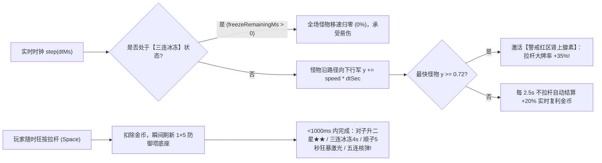

# 方案三：《黄金矿工防线》(Jackpot TD) — 1×5 单线极速塔防游戏设计文档

> **文档编号**：`GDD-04`  
> **所属模块**：方案三完整游戏设计文档 (`docs/gdd/04-scheme3-jackpot-td.md`)  
> **代码映射**：`src/games/jackpot-td/config.js`、`src/games/jackpot-td/JackpotTDEngine.js`、`src/games/jackpot-td/JackpotTDView.js`

---

## 1. 核心概念与 1×5 防御塔底座实时防线拓扑

### 1.1 核心设计定位
* **核心循环**：把 `3×3` 缩减为只有 **1排5格 (`1×5`)** 的单线老虎机，这 5 个格子直接横在怪物进攻的唯一路径上，**既是摇奖机，也是防御塔底座 (`Pedestals 0..4`)**。
* **极简爽点**：怪物实时源源不断地从上方往下走 (`step(dtMs)`)。你随时可以消耗金币按下拉杆，5个格子瞬间刷新防御塔并立刻开火。如果摇出**对子（2个相同）自动合成为二星 (`★★`)**；摇出**顺子或五连（Yahtzee 快艇骰子规则）**，全屏触发**长达 5 秒的狂暴激光洗地 (`5s Hyper Laser Sweep`)**！
* **上头机制**：彻底取消“回合制准备阶段”，变成**即时制的狂按拉杆**。看着怪物快要摸到底线时，疯狂连点拉杆赌一个**“三连冰冻”**或**“五连核弹”**救场，压迫感与绝境翻盘的多巴胺直接拉满！

### 1.2 1×5 单线防线与实时怪物行军路径拓扑
```text
+-----------------------------------------------------------------------+
| [出怪口 y = 0.00]  👾 哥布林先遣队   🛡️ 重甲盾卫   👹 攻城巨兽 BOSS    |
|         ↓                 ↓               ↓               ↓           |
| [正常行军区 y = 0.00 .. 0.71]  防御塔持续自动射击 + 拉杆爆发齐射       |
| - - - - - - - - - - - - - - - - - - - - - - - - - - - - - - - - - - - |
| [🚨 绝境警戒红区 Red Zone y >= 0.72]  触发肾上腺素：大牌概率 +35%！     |
+-----------------------------------------------------------------------+
| [底线防线 y = 0.85]  1×5 单线老虎机防御塔底座 (data-testid="td-slot-bar")|
|  [底座 0]      [底座 1]      [底座 2]      [底座 3]      [底座 4]      |
+-----------------------------------------------------------------------+
```

---

## 2. 六阶防御塔图案图鉴与底座吞噬成长 (`6 Tower Symbols & Pedestal Auto-Devour`)

5个防御塔底座摇出的图案严格对应快艇骰子点数 `1..6`，既能评估顺子/同花顺牌型，又能触发相邻底座**零操作合成 (`Auto-Devour`)**：

| 点数 (`Rank`) | 防御塔 ID (`id`) | 中文名称 | 图标 | 基础筹码 (`BasePoints`) | 持续攻速 (`Shots/s`) | 攻击特效与底座自动吞噬规则 (`Combat & Auto-Devour`) |
|---------------|------------------|--------|------|-------------------------|----------------------|-----------------------------------------------------|
| **1 点** | `miner_pick` | **矿工飞镐塔** | ⛏️ | `20` | `1.5/s` | 每次射击额外掉落 `+3 Gold`；作为高阶塔的优质食材，被吞噬时提供 `+2` 底座吞噬层数 |
| **2 点** | `gold_nugget` | **暴富金砖塔** | 🪙 | `35` | `1.2/s` | 停轮瞬间直接赠送 `+15 Gold`；被相邻高阶塔吞噬时提供 `+4` 吞噬层数与 `+25` 基础点 |
| **3 点** | `cryo_prism` | **极寒冰晶塔** | ❄️ | `50` | `1.4/s` | 发射寒冰射线使怪物减速 `40%`；凑齐 3 个触发全屏 **`三连冰冻 (4秒绝对零度)`** |
| **4 点** | `tesla_coil` | **磁暴线圈塔** | ⚡ | `80` | `1.8/s` | 发射 4 目标连锁闪电；自动吞噬左右相邻的 `miner_pick` / `gold_nugget` 强化电弧 |
| **5 点** | `prism_laser` | **聚能棱镜塔** | 🔦 | `130` | `2.2/s` | 发射贯穿整条兵线的聚焦激光；大幅提升 **`长达5秒的狂暴激光洗地`** 扫射伤害 |
| **6 点** | `nuke_core` | **裂变核芯塔** | ☢️ | `250` | `1.0/s` | 顶级毁灭重炮，自动吞噬左右相邻低阶塔；凑齐五连直接引爆 **`五连核弹`** 清空全屏 |

---

## 3. 快艇骰子 (`Yahtzee`) 牌型判定表与绝境大招 (`Clutch Ultimates`)

每次消耗金币按下 `[狂按拉杆刷新防线 / Pull Lever (Space)]` (`data-testid="btn-pull-lever"`)，系统在 `< 1000ms` 内完成 **牌型判定 -> 对子/三连自动升星 (`★ -> ★★ -> ★★★`) -> 邻域自动吞噬 -> 绝境大招释放**：

| 牌型代号 (`handId`) | 中文牌型名称 | 判定条件 (`1×5` 底座图案) | 连线倍率 (`LineMultiplier`) | 自动升星与全屏绝境大招 (`Auto-Merge & Ultimate Skill`) |
|---------------------|--------------|---------------------------|-----------------------------|--------------------------------------------------------|
| `HIGH_CARD` | **散牌齐射** | 无对子且无顺子 | `×1.0` | 高阶塔自动吞噬相邻 1~2 点食材塔，5座底座同步发射强化弹幕 |
| `ONE_PAIR` | **对子升星 (`二星 ★★`)** | 2 个相同图案 | `×3.0` | **自动合成为二星 (`★★ 2-Star Auto-Merge`)**，伤害翻倍，空出的底座自动补刷金砖供主塔吞噬 |
| `TWO_PAIR` | **双对联装 (`双二星 ★★`)** | 两组 2 个相同图案 | `×8.0` | 同时合成两座 **二星 (`★★`)** 主力塔，发射双倍交叉火力 |
| `THREE_OF_A_KIND` | **三连冰冻 (`三星 ★★★`)** | 3 个相同图案 | `×20.0` | 自动合成为 **三星 (`★★★`)** 巨塔，并立即触发 **【三连冰冻 (`FREEZE_4S`)】**：全屏怪物绝对零度冰冻 **4.0 秒**，绝境救场神技！ |
| `SMALL_STRAIGHT` | **四顺激光 (`小顺子`)** | 任意 4 个连续点数（如 `1-2-3-4`） | `×80.0` | 触发 **【长达 5 秒的狂暴激光洗地 (`HYPER_LASER_5S`)】**：全屏高能激光束持续横扫 **5000ms**！ |
| `FULL_HOUSE` | **满堂彩葫芦 (`★★★ + ★★`)** | 3 个相同 + 2 个相同 | `×45.0` | 同时生成 `★★★` 与 `★★` 巨塔，触发 **4秒全屏冰冻 + 重炮齐射** |
| `LARGE_STRAIGHT` | **五顺狂暴激光 (`大顺子`)** | 5 个连续点数（`1-2-3-4-5` 或 `2-3-4-5-6`） | `×200.0` | 触发超载版 **【长达 5 秒的狂暴激光洗地 (`HYPER_LASER_5S`)】** (`durationMs = 5000`)，每秒结算高频融化伤害！ |
| `FOUR_OF_A_KIND` | **四连轨道炮** | 4 个相同图案 | `×150.0` | 4秒全屏冰冻 + 5秒狂暴激光双重触发 |
| `YAHTZEE_FIVE` | **五连核弹 (`Yahtzee 终极五连`)** | 5 个图案完全相同 | `×1000.0` | 触发 **【五连核弹 (`NUKE_DETONATION`)】** 蘑菇云秒杀全屏一切敌军，并开启 **【长达 5 秒的狂暴激光洗地 (`HYPER_LASER_5S`)】** 镇压后续波次！ |

---

## 4. 实时赌狗复利 (`Real-Time Greed Interest`) vs 警戒红区绝境狂按拉杆 (`Red-Zone Adrenaline`)

### 4.1 忍住不拉杆的实时复利跳字 (`data-testid="td-interest-ticker"`)
* 在怪物向下行军的过程中，玩家每忍住 `2.5秒` 不按拉杆，金库立即结算一次 **`+20%` 实时复利金币 (`accrueRealtimeInterest`)**，同时贪婪连击倍率沿 `1.0x -> 1.5x -> 2.2x -> 3.5x -> 5.0x` 节节攀升。

### 4.2 警戒红区绝境肾上腺素 (`Red-Zone Adrenaline`, `y >= 0.72`)
* 当跑得最快的怪物跨过 `y = 0.72` 的红色警戒线、眼看就要摸到底线 (`y = 0.85`) 时：
  1. 警报红灯闪烁，防线进入 **绝境肾上腺素状态 (`isRedZoneCritical = true`)**；
  2. 此时疯狂连点拉杆，轮盘的 **“三连冰冻”**、**“顺子狂暴激光”** 与 **“五连核弹”** 触发概率自动获得 **`+35%` 绝境气运加成**；
  3. 玩家亲历“憋利息憋到怪贴脸 -> 狂按空格摇出三连冰冻/五连核弹一发清屏”的极致多巴胺过山车！

### 4.3 四类实时行军怪物图鉴
1. **疾行哥布林 (`gob_runner`)**：移速极快 (`speed = 0.14/s`)，逼迫玩家快速反应；
2. **重甲铁盾卫 (`shield_bearer`)**：高血量中速推进 (`speed = 0.08/s`)；
3. **狂暴掘地者 (`tunnel_berserker`)**：半血以下移速翻倍冲刺红区 (`speed = 0.18/s`)；
4. **攻城巨无霸 BOSS (`siege_dreadnought`)**：压阵首领，血量随波次从 `120 HP` 指数膨胀至 `85,000,000 HP`。


---

## 5. 方案三实时步进物理模型与 UI 测试锚点契约 (`Jackpot TD Real-Time Spec`)

### 5.1 实时行军 `step(dtMs)` 与狂按拉杆双轨协同架构
不同于传统回合制塔防，《黄金矿工防线》采用 **连续实时物理帧推进 (`step(dtMs)`)** 与 **任意时刻即时拉杆 (`performPrimaryAction`)** 的双轨架构：



### 5.2 防御塔星级合成与底座永久吞噬成长表 (`Star Merge & Pedestal Stacks`)
| 底座事件 | 触发条件 | 星级与属性变化 | 视觉与音效反馈 |
|----------|----------|----------------|----------------|
| **基础刷塔 (`★ 1-Star`)** | 单次拉杆摇出无重复散牌 | 1星基础属性 (`star = 1`) | 停轮机械卡顿声 (`playReelClack(0..4, 5)`) |
| **对子自动升二星 (`★★ 2-Star`)** | 摇出 `One Pair` 或 `Two Pair` | 相同防御塔自动合成为 **二星 (`★★`, `star = 2`)**，基础点与攻速 `×2.2` | 升调和弦音 (`playComboChime`) + 二星金框特效 |
| **三连自动升三星 (`★★★ 3-Star`)** | 摇出 `Three of a Kind` 或 `Full House` | 自动合成为 **三星 (`★★★`, `star = 3`)**，基础点 `×4.5` 并触发 **4秒三连冰冻** | 冰封破碎冲击波 + 全屏寒霜滤镜 |
| **顺子狂暴激光 (`5s Hyper Laser`)** | 摇出四顺或五顺 (`1-2-3-4-5` / `2-3-4-5-6`) | 激活 `laserRemainingMs = 5000` 全屏高能激光持续横扫洗地 | `playLaserSweep(5000)` + 5秒霓虹青色激光束动画 |
| **五连核弹 (`Yahtzee Nuke`)** | 5 座底座摇出完全相同图案 | 全员升至最高星级，触发 **五连核弹** 秒杀全屏并叠加 **5秒狂暴激光洗地** | `playChainExplosion(4)` + Tier 4 满屏震动 |
| **底座吞噬叠层 (`Pedestal Devour`)** | 高点数塔 (`Rank 4..6`) 相邻低点数塔 (`Rank 1..2`) | 高阶塔自动张嘴吃掉相邻飞镐/金砖，底座永久累加 `devourStacks` | `playDevourCrunch` + 底座紫金暴食光环 |

### 5.3 方案三专属 DOM `data-testid` 契约表
| `data-testid` 属性值 | 对应 UI 组件 | 交互行为与状态验证 |
|----------------------|--------------|--------------------|
| `td-lane-canvas` | 怪物进攻兵线战场容器/画布 | 实时渲染向下行军的怪物群、警戒红区线 (`y = 0.72`)、冰冻特效与 5 秒狂暴激光 |
| `td-slot-bar` | `1×5` 单线老虎机防御塔底座栏 | 横跨路径底部的 5 座防御塔容器 |
| `td-pedestal-0` .. `td-pedestal-4` | 第 0~4 号防御塔底座 | 展示当前防御塔图标、名称、星级 (`★ / ★★ / ★★★`) 与底座吞噬层数 |
| `btn-pull-lever` | 主操作按钮 `[狂按拉杆刷新防线 (Space)]` | 消耗金币立即刷新 5 座防御塔、判定快艇骰子牌型并触发齐射/激光/核弹 |
| `td-interest-ticker` | 实时复利与贪婪连击指示器 | 展示不拉杆时每 2.5s 跳动的 `+20%` 复利倒计时与当前贪婪连击倍率 |
| `td-base-hp` | 防线基地生命值徽章 | 展示当前防线生命值 `playerHp / 100 HP` |
| `td-active-combo` | 当前激活快艇牌型与大招横幅 | 实时展示 `对子二星★★`、`三连冰冻 (4.0s)`、`5秒狂暴激光洗地` 或 `五连核弹` |
